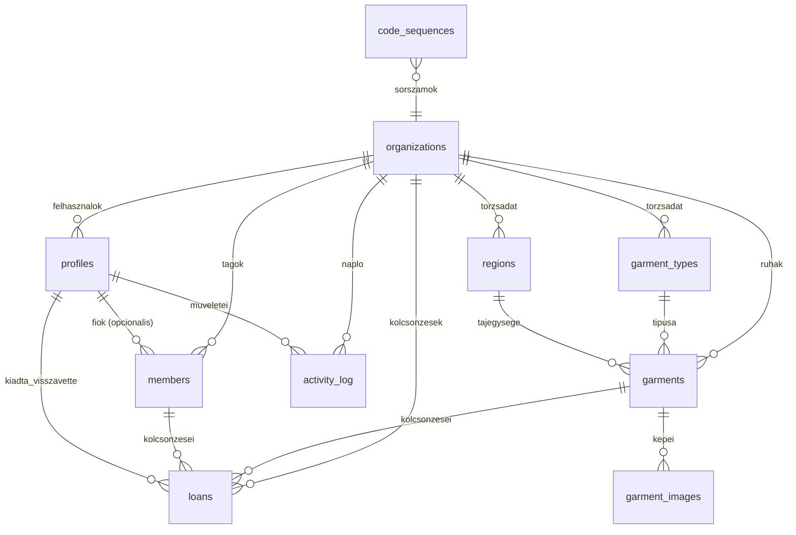

# Terv

> **Mit építünk?** Ez a dokumentum a rendszer tartalma: képernyők, navigáció, szerepkörök – és ide kerülnek a követelmények és az adatmodell is. Ugyanez a felépítés lesz a Next.js útvonal-struktúrája.

**Tartalom:** Adatmodell · Képernyők és navigáció · Nyitott kérdések · Indulási ellenőrzőlista

> **Kész:** az adatmodell (táblák, megkötések, indexek, azonosítóképzés, állapotgép) és a képernyők/navigáció.
> **Következik:** a követelmények (szerepkörönkénti felhasználói történetek), az architektúra-ábra és a wireframe-ek.

## Adatmodell

> Az adatbázis **PostgreSQL** (Supabase), a séma verziókövetett SQL migrációkkal készül. A tábla- és oszlopnevek **angolul** vannak (a magyar megnevezés a felület dolga).

### Elvek

1. **Elsődleges kulcs mindig `id`** (`uuid`), idegen kulcs `<tábla_egyes_szám>_id` (pl. `garment_id`).
2. **Minden táblán van `organization_id`** – ma egyetlen egyesület van benne, de így a több egyesület (multi-tenant) támogatása később nem igényel táblák átírását. (Ez tudatos előkészítés, nem megvalósított funkció.)
3. **Törlés helyett deaktiválás:** `is_active boolean`. A napló és az előzmények hivatkoznak a régi sorokra, ezért nem tűnhetnek el.
4. **Időbélyegek mindenhol:** `created_at`, `updated_at` (utóbbi triggerrel frissül).
5. **A naplózás külön tábla** (`activity_log`), nem elszórt mezők – minden írási művelet ide kerül.
6. **A „lejárt” állapotot nem tároljuk** – kiszámítjuk (`due_at < ma` és `returned_at` üres). Ha tárolnánk, minden éjszaka frissíteni kellene, és elavulna.

### Táblák

| Tábla | Mi van benne | Fontos mezők |
| --- | --- | --- |
| `organizations` | az egyesület (egyelőre 1 sor) | `id`, `name`, `slug` |
| `profiles` | belépő felhasználók (Supabase Auth-hoz kapcsolva) | `id` (= auth azonosító), `organization_id`, `display_name`, `role`, `is_active` |
| `members` | **egyesületi tagok** (nem feltétlenül van fiókjuk!) | `id`, `organization_id`, `full_name`, `email`, `phone`, `member_since`, `is_active`, `user_id` (opcionális fiók-kapcsolat) |
| `garment_types` | ruhatípusok | `id`, `organization_id`, `code` (pl. `ING`), `name`, `sort_order`, `is_active` |
| `regions` | tájegységek | `id`, `organization_id`, `slug`, `name`, `is_active` |
| `garments` | ruhák | `id`, `organization_id`, `inventory_code`, `garment_type_id`, `region_id`, `size`, `color`, `condition`, `status`, `acquired_at`, `value_huf`, `notes`, `is_active` |
| `garment_images` | ruhaképek | `id`, `garment_id`, `storage_path`, `position`, `is_primary` |
| `loans` | kiadás–visszavétel | `id`, `organization_id`, `garment_id`, `member_id`, `loaned_at`, **`due_at` (lehet üres!)**, `returned_at`, `condition_out`, `condition_in`, `loaned_by`, `received_by`, `notes` |
| `activity_log` | műveleti napló | `id`, `organization_id`, `actor_user_id`, `action`, `entity_type`, `entity_id`, `before` (jsonb), `after` (jsonb), `occurred_at`, `ip`, `user_agent` |
| `code_sequences` | az egyedi azonosítók sorszáma | `organization_id`, `prefix`, `last_value` (összetett kulcs) |

**Két kulcsdöntés, amit érdemes külön megérteni:**

- **`members` ≠ `profiles`.** Az egyesületi tag lehet, hogy soha nem lép be a rendszerbe – ő csak egy személy a nyilvántartásban (a leltáros rögzíti). Aki viszont belép (leltáros, adminisztrátor), annak fiókja van. A kettőt a `members.user_id` köti össze, de csak ha van fiók.
- **A ruha és a tag kapcsolata nem a ruhában van**, hanem a `loans` táblában – így megmarad a teljes előzmény (ki, mikor, meddig), nem csak az, hogy „most kinél van”.

### Kapcsolatok



### Megkötések és indexek – a helyesség és a gyorsaság garanciái

A hibás állapotot **nem a felületre bízzuk**: amit az adatbázis meg tud tiltani, azt meg is tiltjuk.

| Megkötés | Miért fontos |
| --- | --- |
| `garments.inventory_code` egyedi (szervezetenként) | nem születhet két azonos kódú ruha |
| **részleges egyedi index:** `loans UNIQUE (garment_id) WHERE returned_at IS NULL` | egy ruhán egyszerre **egy** nyitott kölcsönzés lehet – ezt az adatbázis garantálja, nem az alkalmazás |
| `CHECK` a `status` és `condition` mezőn | csak a megengedett értékek kerülhetnek be |
| `CHECK (value_huf >= 0)`, `CHECK (returned_at IS NULL OR returned_at >= loaned_at)` | nincs negatív érték, nincs időben fordított visszavétel |
| `CHECK (due_at IS NULL OR due_at >= loaned_at)` | **határozatlan határidő megengedett**, de értelmetlen dátum nem |
| idegen kulcsok `ON DELETE RESTRICT` | nem tűnhet el olyan sor, amire napló vagy kölcsönzés hivatkozik |

| Index | Mire kell |
| --- | --- |
| `(organization_id, status)` | a „raktárban / kiadva" gyors szűrő |
| `(organization_id, garment_type_id)`, `(organization_id, region_id)` | a típus- és tájegység-szűrő |
| `inventory_code` (egyedi) | kód szerinti keresés – ez a leggyakoribb |
| `pg_trgm` GIN a `notes`, `size`, `color` mezőn | részleges, **ékezet nélküli** keresés |
| `loans (due_at) WHERE returned_at IS NULL` | a lejárt határidők listája |
| `activity_log (organization_id, occurred_at DESC)` | napló időrendben |
| `members (organization_id, full_name)` | tag keresése |

> A mintaadat most 180 ruha, de a terv **1000+ ruhára** készül. Ezért a lista **szerveroldalon** szűr, rendez és lapoz, és egyszerre csak 25/50/100 sor jön át a hálózaton.

### Egyedi azonosítók

| Rész | Megoldás |
| --- | --- |
| Belső kulcs | `uuid` – technikai, a felületen soha nem látszik |
| Emberi kód | `TÍPUS-SORSZÁM`, pl. `ING-0042` – ez van a címkén, a QR-kódban és a keresőben |
| Előtag | a `garment_types.code` (pl. `ING`), típusonként **újrainduló** sorszámmal |
| Sorszám | a `code_sequences` tábla adja **tranzakcióban, sorzárral** (`SELECT … FOR UPDATE`) – párhuzamos felvitelnél sem születik két azonos kód |
| QR-kód tartalma | mélylink: `https://<domain>/g/ING-0042` – beolvasva egyenesen a ruha adatlapjára visz |

**Miért kell mindkettő?** Mert a sorszám emberi név: kitalálható és előbb-utóbb ütközik; a UUID viszont kimondhatatlan telefonon. A kettő együtt adja a biztonságot *és* a használhatóságot.

### Kiadás és visszavétel – az állapotgép

```
available ──kiadás──▶ loaned ──visszavétel (jó állapot)──▶ available
                        │
                        ├── visszavétel sérülten ──▶ repair ──(javítás)──▶ available
                        └── nem kerül elő ─────────▶ lost
```

1. Egy ruhán **egyszerre egy nyitott kölcsönzés** lehet (ezt a részleges egyedi index kényszeríti ki, nem a kód).
2. Kiadáskor rögzítjük a ruha állapotát (`condition_out`), visszavételkor a visszakapott állapotot (`condition_in`) – így utólag látszik, ki mit rontott el.
3. **A „lejárt" nem állapot, hanem jelző:** `due_at` ki van töltve, elmúlt, és `returned_at` üres. A felület ezt jelvényként mutatja.
4. Minden lépés bekerül a naplóba: ki, mikor, mit, milyen értékről milyenre.

## Képernyők és navigáció

### Navigációs elvek

1. **Legfeljebb 6 menüpont.** Ha több lenne, az nem navigáció, hanem hiányzó csoportosítás.
2. **A szerepkör szűri a menüt.** Amit nem lehet, azt nem is látja – de a **védelem a szerveren van** (`requirePermission`), a menü csak nem kínálja fel.
3. **Minden szűrő az URL-ben él** (`?allapot=kiadva&q=ing`). Előnye: a link megosztható, a vissza gomb működik, az oldal újratölthető, a szűrés könyvelhető a böngészőben.
4. **Minden képernyő mélylinkelhető**, és a bejelentkezés utáni visszatérés ugyanoda visz vissza.
5. **Egy képernyő = egy feladat.** A ruha adatlapja nem ruha-szerkesztő és nem kiadási folyamat egyszerre: ott gombok vannak, amik a megfelelő folyamatra visznek.
6. **Mobilon a lényeg két kattintáson belül** (beolvasás → ruha → kiadás/visszavétel).

### Site map

```
Bejelentkezés előtt
├─ /bejelentkezes
├─ /regisztracio            (meghívásos; lásd ADR-0002)
└─ /elfelejtett-jelszo

Bejelentkezés után (AppShell: oldalsáv / mobil alsó sáv)
├─ /attekintes              összesítők, lejárt határidők, friss napló
├─ /ruhak                   lista, keresés, szűrés, lapozás
│   ├─ /ruhak/uj            új ruha felvétele (képpel, automatikus azonosítóval)
│   └─ /ruhak/[kod]         ruha adatlapja
│       └─ /ruhak/[kod]/szerkesztes
├─ /tagok                   tagok listája
│   ├─ /tagok/uj
│   └─ /tagok/[id]          tag adatlapja (kiadásban lévő ruhái)
├─ /kiadas                  (november) kiadás ÉS visszavétel egy képernyőn, két fül
├─ /naplo                   (november) tevékenységnapló, szűrve
├─ /sajat                   tag: a saját kiadásaim és határidőim
├─ /profil                  saját adatok, jelszó, téma
└─ /beallitasok             (admin)
    ├─ /beallitasok/ruhatipusok
    ├─ /beallitasok/tajegysegek
    └─ /beallitasok/felhasznalok

Mindenki számára (bejelentkezés nélkül is működik)
└─ /g/[kod]                 QR-mélylink → a ruha adatlapjára visz (bejelentkezés után)
```

### Útvonal-tábla

| Útvonal | Cél | Szerepkör | Fő elemek |
| --- | --- | --- | --- |
| `/bejelentkezes` | belépés | vendég | űrlap, hibák magyarul, „elfelejtett jelszó” |
| `/regisztracio` | fiók létrehozása | vendég | meghívó kód vagy admin általi létrehozás (ADR-0002) |
| `/elfelejtett-jelszo` | jelszó-visszaállítás | vendég | e-mail kérés, visszajelzés |
| `/attekintes` | összesítő | mindenki | darabszámok, kiadva, lejárt, utolsó naplóbejegyzések |
| `/ruhak` | ruhaállomány | admin, leltáros | kereső, szűrők, lista vagy kártyalista, lapozás, „Új ruha” |
| `/ruhak/uj` | felvétel | admin, leltáros | kötelező mezők elöl, kép feltöltés, **rendszer javasolja a típust**, a felhasználó jóváhagyja |
| `/ruhak/[kod]` | adatlap | admin, leltáros | adatok, képek, **kiadási előzmények**, műveletek (kiadás, visszavétel, szerkesztés, állapot) |
| `/ruhak/[kod]/szerkesztes` | módosítás | admin, leltáros | mint a felvétel, az azonosító nem módosítható |
| `/tagok` | tagok | admin, leltáros | kereső, szűrő (aktív/inaktív), darabszám |
| `/tagok/uj`, `/tagok/[id]`, `/tagok/[id]/szerkesztes` | tag kezelés | admin, leltáros (adatmódosítás: admin) | személyes adatok, **éppen nála lévő ruhák**, előzmények, deaktiválás |
| `/kiadas` | kiadás és visszavétel (két fül) | admin, leltáros | kiadás: tag + **több ruha egy folyamatban**, határidő (lehet határozatlan); visszavétel: kód beolvasása, állapot rögzítése, sérülés megjegyzéssel |
| `/naplo` | tevékenységnapló | admin, leltáros | szűrés műveletre, felhasználóra, tárgyra, dátumra; előtte/utána összevetés |
| `/sajat` | saját kiadások | tag | nálam lévő ruhák, határidő, előzmények |
| `/beallitasok/*` | törzsadatok, felhasználók | admin | ruhatípusok, tájegységek (létrehozás, átnevezés, deaktiválás) |
| `/g/[kod]` | QR-mélylink | mindenki | ha nincs bejelentkezve: bejelentkezés, majd ide vissza; mobilon gyors műveletek |

**Nyelvi döntés:** az **URL-ek magyarul** vannak (a felhasználó látja és megosztja őket – ez felhasználói szöveg), a **kód, fájlnevek és adatbázis angolul** (`AGENTS.md` 3. pont). Így a link `/ruhak/ING-0042`, a fájl `src/app/ruhak/[kod]/page.tsx`, a tábla pedig `garments`.

### Szerepkörök és jogosultságok

| Képernyő / művelet | Adminisztrátor | Leltáros | Tag |
| --- | --- | --- | --- |
| Áttekintés | teljes | teljes | saját nézet |
| Ruhák listája, adatlap | ✔ | ✔ | – |
| Ruha felvétele, módosítása | ✔ | ✔ | – |
| Ruha archiválása (törlés) | ✔ | – | – |
| Tagok listája | ✔ | ✔ (kiadáshoz szükséges) | – |
| Tag személyes adatainak módosítása | ✔ | – | saját profil |
| Kiadás / visszavétel | ✔ | ✔ | – |
| Napló áttekintése | ✔ | ✔ | – |
| Törzsadatok (ruhatípusok, tájegységek) | ✔ | – | – |
| Felhasználók és szerepkörök kezelése | ✔ | – | – |
| Saját kiadásaim (`/sajat`) | – | – | ✔ |

**Két alapelv, ami az adatmodellre is hat:**
1. **Törlés helyett archiválás.** Ruhát és tagot nem törlünk, csak `active = false`, mert a napló és az előzmények hivatkoznak rájuk. Az archivált elemek alapból nem látszanak a listákban, de a naplóban igen.
2. **A jogosultság a szerveren dől el.** A fenti tábla a *felületről* szól; ugyanez a szabály `can(user, action, resource)` formában külön modulban is megvan, egységtesztekkel (ez az októberi követelmény).

### Navigációs váz

**Asztali oldalsáv (240 px, csoportosítva):**

```
Áttekintés
Ruhák                    → lista, új ruha
Kiadás / Visszavétel     (novembertől)
Tagok
Napló                    (novembertől)
─────
Beállítások              (csak adminnak)
```

**Fejléc (56 px):** balra az aktuális oldal címe, jobbra a **gyorskereső** (ruha kódjára vagy tag nevére), a téma váltó (világos / sötét / rendszer) és a profil menü (profil, kijelentkezés).

**Mobil alsó sáv (5 hely, hüvelykujjal elérhető):** `Áttekintés` · `Ruhák` · **`Új ruha`** (kiemelt, középen, accent) · `Tagok` · `Több`.

- A középső kiemelt művelet jelenleg az **Új ruha**, mert ez a leggyakoribb mobil feladat. Amikor a QR-beolvasás elkészül (november), a középre a `Beolvasás` kerül, és az `Új ruha` visszakerül a listába.
- A `Több` egy fiókot nyit (Sheet): Kiadás, Visszavétel, Napló, Beállítások, Profil.
- **Miért nem hamburger menü?** Mert a négy leggyakoribb feladat (áttekintés, ruhák, beolvasás, tagok) egy koppintásra van, és egy kézzel is elérhető. A hamburger minden műveletet két koppintásra és egy „hova is tűnt a menü” kérdésre cserélne.

### URL-szerződés (szűrés, lapozás, rendezés)

Elv: **a lista állapota az URL-ben van**, nem a komponensben.

| Paraméter | Jelentés | Értékek |
| --- | --- | --- |
| `q` | szabad szöveges keresés | kód, megnevezés, méret, megjegyzés |
| `tipus` | ruhatípus | a típustábla kódja (pl. `ing`) |
| `tajegyseg` | tájegység | slug (pl. `paloc`) |
| `meret` | méret | típusonkénti lista |
| `allapot` | ruha állapota | `jo`, `viselt`, `javitasra_var` |
| `statusz` | kölcsönzési állapot | `kiadhato`, `kiadva`, `lejart` |
| `keszlet` | gyors szűrő: hol van a ruha | `raktar` (kiadható), `kiadva` (kiadva **vagy** lejárt) |
| `tag` | tag azonosítója | a nála lévő ruhák szűrése |
| `oldal` | lapszám | 1-től |
| `sor` | lapméret | 25 / 50 / 100 |
| `rendez` | rendezési szempont | `kod`, `tipus`, `felvetel`, `hatarido` |
| `irany` | rendezés iránya | `novekvo`, `csokkeno` |

**Szabályok:**

1. Az ismeretlen paramétert csendben figyelmen kívül hagyjuk.
2. Az érvénytelen érték az alapértékre esik vissza – a szűrő nem hibázik el.
3. Az alapértelmezett érték **nem** kerül a linkbe (nincs `?oldal=1&sor=50` a címsorban).
4. A szerkesztő oldalak `?vissza=` paramétert kapnak, hogy a „Mégsem” és a „Mentés” ugyanoda térjen vissza, megtartva a szűrést.
5. Minden szűrő egy gombbal törölhető („Szűrők törlése”).
6. A lapozás a felületen `oldal`-alapú, az adatbázisban viszont **keyset** módszerrel történik (az utolsó ismert kulcs után), így nagy állománynál sem lassul.

Példa: `/ruhak?tipus=ing&statusz=kiadva&rendez=hatarido&irany=csokkeno&q=paloc`

### Képernyő-leltár – mi legyen minden lista- és adatlap-képernyőn

Ez a „kész-definíció” a felületre. Egy listaoldal addig nem kész, amíg mindegyik pont megvan:

- **gyors szűrő a lista tetején**: Mind / Raktárban / Kiadva, darabszámmal – egy kattintás, linkkel (nem kell a szűrősávval bajlódni),
- kereső (késleltetéssel) és törlés gomb,
- legfeljebb 4 szűrő egy sorban + „több szűrő”,
- találati darabszám, rendezés, lapméret,
- **üres állapot**: egy mondat + cselekvés („Nincs találat. Szűrők törlése”),
- **betöltés**: skeleton sorok (nem középre tett pörgő ikon),
- **hiba**: magyar üzenet + „Újra” gomb,
- soronkénti műveletek a `⋯` menüben (megnyitás, szerkesztés, kiadás, előzmények),
- az elsődleges művelet az oldalfejlécben (pl. „Új ruha”),
- mobilon ugyanaz a lista kártyákként, a kártyán a három legfontosabb adat.

**A ruha adatlapjának minimuma:** azonosító olvashatóan (tabuláris számjegy) + QR-nyomtatás; állapot-jelvény és állapotváltás; a 4–5 legfontosabb adat; képek; **„ki viszi most” kiemelve**; kölcsönzési előzmények időrendben; a napló erre a ruhára szűrve.

### Átmeneti helyek (október–november)

- A novemberi és decemberi menüpontok (Kiadás, Visszavétel, Napló, Beállítások) **láthatók a menüben**, és a képernyőjük rövid magyarázatot ad arról, mi kerül ide és mikor. A bemutatón ez segít, mert látszik a teljes rendszer és a tervezett funkciók helye. Éles használat előtt külön döntés: maradjon-e így, vagy csak a működő menüpontok látszódjanak.
- A kódban a mappák már a helyükön vannak, így novemberben nem kell a navigációs vázat átépíteni.

## Nyitott kérdések

Ezekre az egyesülettől kell válasz, és egyben a januári használhatósági teszt kiindulópontjai:

1. Ki használja a rendszert telefonon? (ez dönti el a mobil nézet prioritását)
2. Bejelentkeznek-e a tagok, vagy ők csak kölcsönzők, akiket a leltáros rögzít?
3. ~~Kötelező-e a kiadási határidő, vagy csak az esemény dátumát rögzítjük?~~ → **Válasz (2026-10-14.): a kiadás alapesetben határozatlan idejű**, a határidő megadása lehetőség. Ezért a `due_at` mező null-t is tárolhat, és a „lejárt” állapot csak kitöltött határidőnél értelmezhető.
4. Egyszerre hány ruhát visznek el egy tag? (a kiadási folyamat ehhez igazodik)
5. Van-e olyan darab, ami nem adható ki (bemutató, kiállítási darab)?
6. Ki lesz az adminisztrátor a gyakorlatban, és hány fő?
7. A méretek zárt listából választhatók, vagy szabad szövegesek? (adatmodell-kérdés)
8. Az állapotot (jó / viselt / javításra vár) ki állapítja meg, kell-e hozzá megjegyzés és fotó?

## Indulási ellenőrzőlista (október vége – november eleje)

Ez az a lista, amit **a kódolás komolyabb része előtt** le kell zárni. Ha valamelyik pont hiányzik, az a fejlesztés közben blokkol – nem a végén.

### A. Adat és követelmény (blokkoló)

- [ ] A **nyitott kérdésekre** (fent) válasz érkezett az egyesülettől – különösen: zárt vagy szabad a méretlista, kötelező-e a kiadási határidő, bejelentkeznek-e a tagok, egyszerre hány ruha.
- [ ] **Adatmodell v1**: táblák, mezők, megkötések, indexek (a „Adatmodell” szakasz ide kerül).
- [ ] **Valódi törzsadatok**: a ruhatípusok és tájegységek tényleges listája az egyesülettől, és 20–50 minta ruha a seed-adatokhoz.
- [ ] **Fotószabály**: hosszú él max. 1600 px, bélyegkép 400 px, WebP; a fájltár szerkezete (`garments/{azonosító}/{sorszám}.webp`).

### B. Technikai előkészítés (egyszeri, kb. fél nap)

- [ ] Node.js 24 LTS, `pnpm`, Docker Desktop, Supabase CLI telepítve.
- [ ] Git repó inicializálva, `.gitignore`, első commit; **privát GitHub repo**, mert a folyamatos munkatörténet a dolgozatnál bizonyíték.
- [ ] Supabase projekt létrehozva (felhő) **és** a lokális adatbázis is indul (`supabase start`).
- [ ] `.env.example` a repóban, `.env.local` a gépen – kulcs nem kerül commitba.
- [ ] Üres projektben is zöld: `pnpm lint`, `pnpm typecheck`, `pnpm test` (ez lesz a CI alapja).
- [ ] Migrációs rutin kipróbálva: `generate` → `migrate` → `reset` (a „csak új migráció” szabály csak így tartható be).

### C. Kód-minták – innen jön a sebesség

- [ ] `globals.css` a design tokenekkel (világos és sötét értékekkel).
- [ ] `AppShell` (oldalsáv, mobil alsó sáv, téma váltó) – ez egyben a design-bemutató tárgya.
- [ ] **Három minta fájl**, amit a többi oldal másol:
  - **service-minta**: `requirePermission` → üzleti szabály → `withAudit` → `Result<T>`;
  - **listaoldal-minta**: szűrők az URL-ben, lapozás, üres és hibaállapot;
  - **űrlapminta**: Zod séma + szerver akció + magyar hibaüzenet.

### D. Első „vékony szelet” (vertical slice) – a teljes lánc bizonyítása

Sorrend, mindegyik végigmegy az összes rétegen (adatbázis → szolgáltatás → felület):

1. **Bejelentkezés + szerepkör** (`/bejelentkezes`, `requirePermission`, `can()`).
2. **Ruhatípusok és tájegységek kezelése** – a legegyszerűbb entitás, de már jogosultsággal és naplózással. Ez adja a mintát minden további képernyőhöz.
3. **Tagok**: lista, keresés, felvitel.
4. **Ruhák**: lista, felvitel (azonosítógenerálás, képfeltöltés, állapot), adatlap.

### E. Amit szándékosan NEM építünk az első félévben

A határidő védelme érdekében kimarad: natív mobil alkalmazás, offline mód, e-mail értesítések, statisztika- és riportoldal, exportok, sérülés-munkafolyamat részletei, több egyesület kezelése. **Kivétel:** a több egyesülethez szükséges `organization_id` oszlop már az adatmodellben benne lesz, csak a funkció nem készül el (így később nem kell minden táblát átírni).

